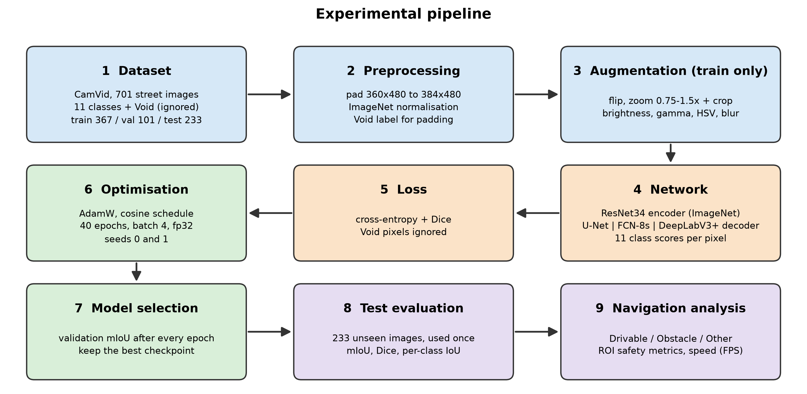
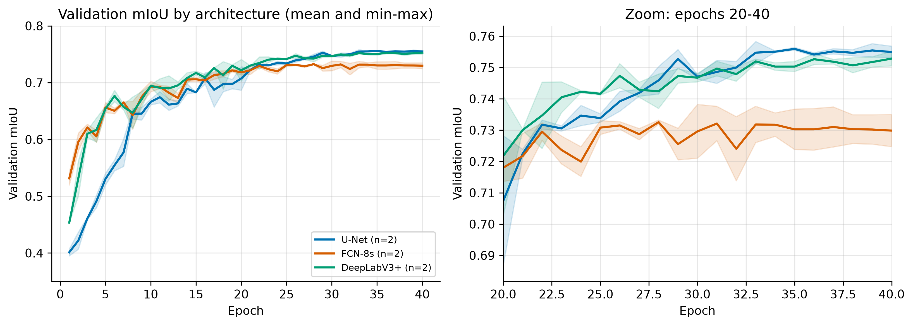
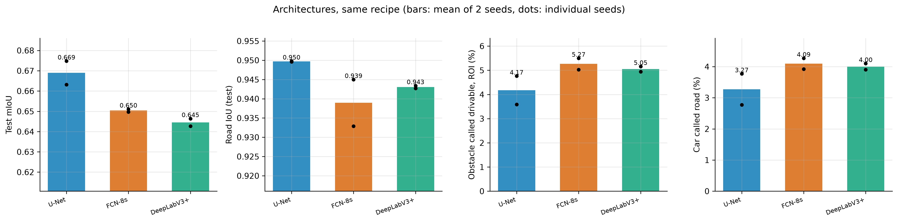
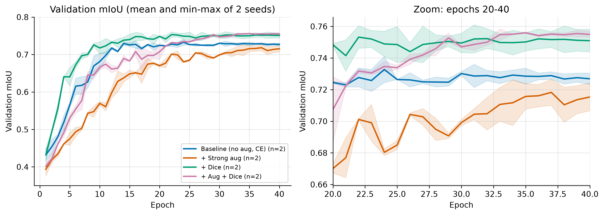
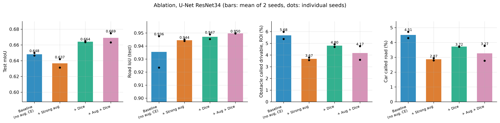
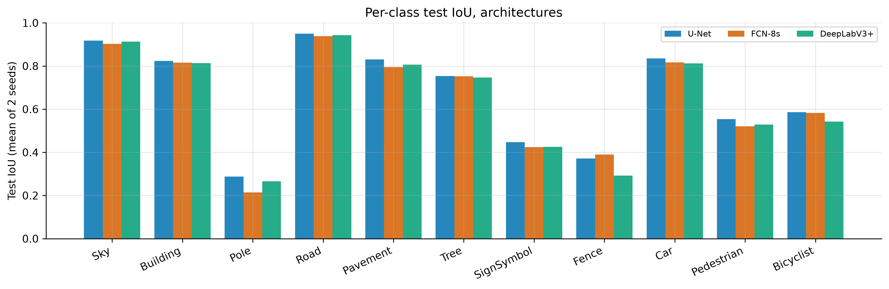
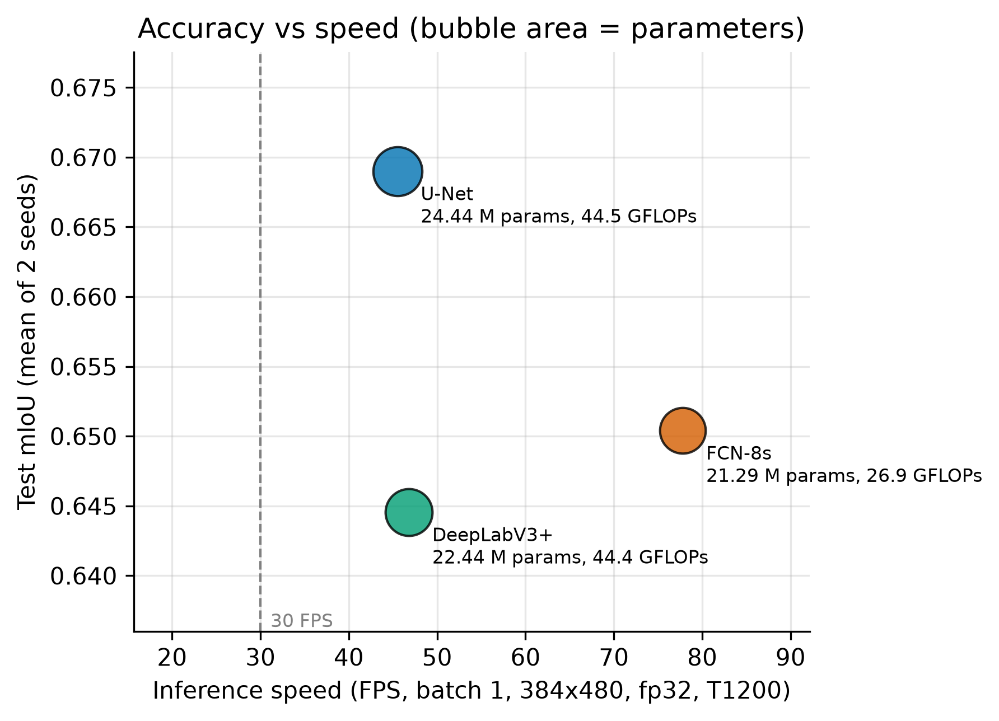
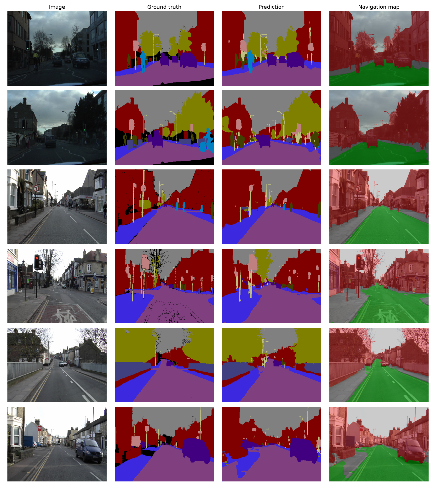
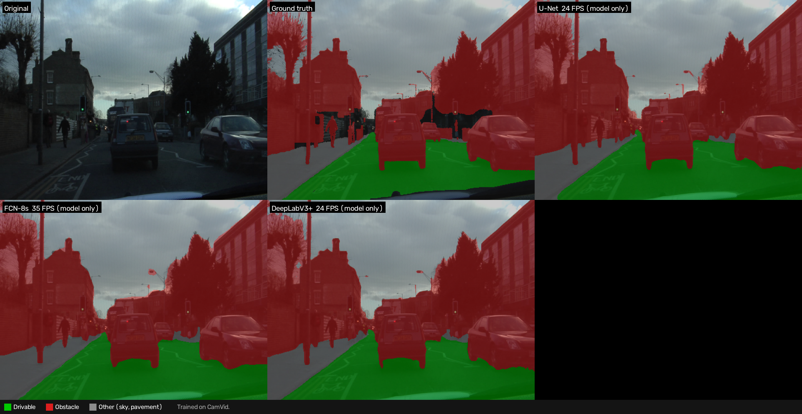

# Semantic Segmentation for Navigation on CamVid

Pixel-level segmentation of street scenes to separate **drivable road** from **obstacles**. Three architectures (U-Net, FCN-8s, DeepLabV3+), all built on the same ImageNet-pretrained ResNet34 encoder, are trained under one protocol and compared. Before the comparison, the loss function and the data augmentation were studied with a small ablation on the U-Net.



## Main results

Test set (233 images), mean of two seeds (0 and 1). All models use the same recipe: strong augmentation, cross-entropy + Dice loss, 40 epochs.

| Model | Test mIoU | Test Dice | Road IoU | Obstacle called drivable (ROI) | Car called road | Params | GFLOPs | FPS |
|---|---|---|---|---|---|---|---|---|
| **U-Net** | **0.669** | **0.779** | **0.950** | **4.17%** | **3.27%** | 24.4M | 44.5 | 45.5 |
| FCN-8s | 0.650 | 0.763 | 0.939 | 5.27% | 4.09% | 21.3M | 26.9 | 77.8 |
| DeepLabV3+ | 0.645 | 0.757 | 0.943 | 5.05% | 4.00% | 22.4M | 44.4 | 46.8 |

FPS: input 384 x 480, batch size 1, fp32, model forward pass only, NVIDIA T1200 Laptop GPU (4 GB), median of 5 repeats.

Ablation on the U-Net (two-seed means):

| Recipe | Augmentation | Loss | Val mIoU | Test mIoU | Road IoU | Obstacle called drivable (ROI) | Car called road |
|---|---|---|---|---|---|---|---|
| Baseline | none | CE | 0.728 | 0.648 | 0.936 | 5.68% | 4.51% |
| + strong augmentation | strong | CE | 0.715 | 0.637 | 0.945 | 3.67% | 2.87% |
| + Dice | none | CE + Dice | 0.752 | 0.664 | 0.947 | 4.80% | 3.72% |
| + augmentation + Dice | strong | CE + Dice | 0.755 | 0.669 | 0.950 | 4.17% | 3.27% |

"ROI" is a driving corridor in front of the vehicle (see `camvid-segmentation/README.md`). Full per-seed numbers, per-class results and caveats: [`camvid-segmentation/RESULTS.md`](camvid-segmentation/RESULTS.md).

## Findings

- **Adding the Dice term to cross-entropy is the main improvement** (+1.6 test mIoU points without augmentation, +3.2 with it). It held in both seeds and on validation.
- **Strong augmentation alone lowered mIoU** (-1.2 points), mostly on thin classes (Pole, Fence). Together with Dice its extra effect (+0.5 points) is smaller than the seed-to-seed spread, so it is not established. It did reduce obstacle-called-drivable and car-called-road errors when used with plain cross-entropy.
- **U-Net is the most accurate of the three architectures** on test and on every navigation measure. DeepLabV3+ needs the same compute and runs at about the same speed, so it offers no advantage here. FCN-8s is about 1.7 times faster (78 vs 46 FPS) with 40% fewer GFLOPs, at a cost of about 1.9 mIoU points. All three run above 30 FPS on the laptop GPU.
- **Thin and small classes remain hard** for every model: Pole stays at 0.21 to 0.29 IoU and Fence at 0.29 to 0.39.
- Large classes are reliable: Road IoU is about 0.95 and the 3-group (drivable / obstacle / other) mIoU is about 0.92 for the first baseline model.

## Figures

| | |
|---|---|
|  |  |
|  |  |





Qualitative examples from the first baseline model (columns: image, ground truth, prediction, navigation map with green = drivable, red = obstacle, gray = other):



## Demo video



A short street-video demo runs the three trained models side by side and overlays the navigation map (green = drivable, red = obstacle, gray = other). Open [`demo.mp4`](camvid-segmentation/results/demo/demo.mp4) on GitHub to play it. The speed shown for each model in the video is the model forward pass only. The models were trained on CamVid only (Cambridge, 2008, daytime), so on footage from other cameras, countries or lighting the results are noticeably worse. The input clip is not part of this repository.

## Repository layout

```
camvid-segmentation/
  src/         dataset.py, model.py, train.py, eval_run.py, evaluate.py,
               nav_metrics.py, measure.py, make_figures.py, demo.py
  results/     ablation.csv, efficiency.csv, runs/<name>/ (logs and metrics), figures/, demo/
  README.md    method, evaluation protocol, how to reproduce
  RESULTS.md   complete record of every run
  requirements.txt
```

Weights and the dataset are not stored in the repository.

## Quick start (Windows PowerShell)

```
cd camvid-segmentation
py -3.12 -m venv .venv
.\.venv\Scripts\Activate.ps1
pip install torch==2.11.0 torchvision==0.26.0 --index-url https://download.pytorch.org/whl/cu128
pip install -r requirements.txt
```

Data download, training, evaluation and figure commands are in [`camvid-segmentation/README.md`](camvid-segmentation/README.md).

## Limitations

- Two seeds per setting; differences below about 1 mIoU point are not reliable. The validation set has 101 images and the test frames come from a few video sequences, so neighboring frames repeat the same mistakes.
- One shared training recipe was used, chosen from the U-Net ablation. FCN-8s and DeepLabV3+ might do better with their own settings.
- The driving corridor (ROI) is hand-chosen. The ROI pavement-to-road rate varied a lot between seeds and is not used for conclusions.
- Speed was measured on one laptop GPU in fp32 with the model forward pass only (no image loading or post-processing); other hardware gives different absolute numbers. An earlier measurement was invalid because the laptop GPU was power-limited; this is documented in `camvid-segmentation/RESULTS.md`, section 11.3.

## Data and references

- CamVid: G. J. Brostow, J. Fauqueur, R. Cipolla, "Semantic object classes in video: A high-definition ground truth database", Pattern Recognition Letters, 2009. The 11-class split (367 / 101 / 233) comes from the SegNet-Tutorial repository (alexgkendall/SegNet-Tutorial).
- U-Net: O. Ronneberger, P. Fischer, T. Brox, MICCAI 2015.
- FCN: J. Long, E. Shelhamer, T. Darrell, "Fully Convolutional Networks for Semantic Segmentation", CVPR 2015.
- DeepLabV3+: L.-C. Chen, Y. Zhu, G. Papandreou, F. Schroff, H. Adam, "Encoder-Decoder with Atrous Separable Convolution for Semantic Image Segmentation", ECCV 2018.
- ResNet: K. He, X. Zhang, S. Ren, J. Sun, "Deep Residual Learning for Image Recognition", CVPR 2016.
- Libraries: PyTorch, segmentation-models-pytorch (P. Iakubovskii), Albumentations (A. Buslaev et al., 2020).
